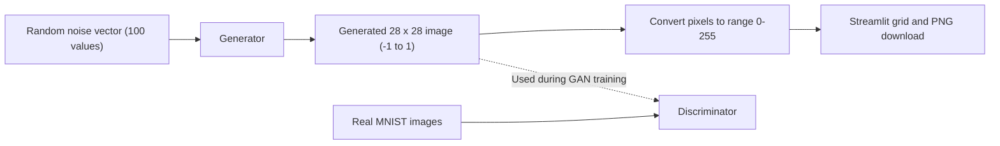

# DigitForge AI — Handwritten Digit Generation Studio

Streamlit app that generates new 28×28 handwritten digits with a trained DCGAN Generator (TensorFlow/Keras, MNIST).
Based on the reference implementation: `rohanmistry231/Deep-Learning-Projects`, Project 09 (follows the TensorFlow DCGAN tutorial).

## Architecture





## Run locally
```bash
pip install -r requirements.txt
# copy your trained file to artifacts/dcgan_generator.h5
pytest -q
streamlit run app.py
```

## Deploy on Hugging Face Spaces
1. Create a Space → SDK **Streamlit**. Add to the top of README: `sdk: streamlit`, `app_file: app.py`, `python_version: 3.10`.
2. `git lfs track "*.h5"` (the model is a binary file), then commit and push; log in through `huggingface-cli login` or the website (never share tokens in chat).
3. Smoke test: open the Space, press **Generate Digits**, check the grid renders and a PNG downloads.
Troubleshooting: load error → re-export with `generator.save("generator.keras")` in the same TF version as `requirements.txt`; build fails → check pinned versions.

## Training
The notebook does not save the Generator or loss history. Add after training in Colab:
```python
generator.save("dcgan_generator.h5")
import json; json.dump({"epochs": EPOCHS, "batch_size": 256, "generator_loss": gl, "discriminator_loss": dl}, open("training_history.json","w"))
```
(collect `gl`/`dl` per epoch from `train_step`'s returned losses). Do a 5-epoch smoke run first.

## Limitations
No digit-class control (needs a conditional GAN); occasional malformed digits; possible mode collapse.

## 3-minute demo script
1. Problem: generating, not classifying, digits. 2. G vs D explained with the diagram. 3. Live: Generate Digits, change count, download a PNG. 4. Model + Training insights tabs. 5. Limitations and conditional-GAN future work.
